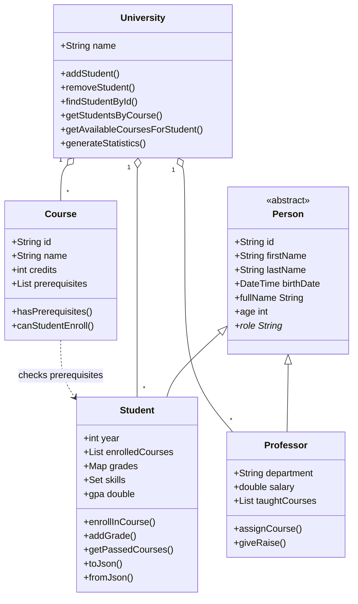

# dart-basics-novitskyi

Практична робота з основ Dart: змінні, функції, ООП (University Management System), колекції, async + файли.

## Встановлення Dart SDK (3.0+)
- Windows: `choco install dart-sdk` або https://dart.dev/get-dart
- macOS: `brew tap dart-lang/dart && brew install dart`
- Linux: https://dart.dev/get-dart#install-using-apt-get
- Перевірка: `dart --version`

## Встановлення проєкту
```bash
git clone https://github.com/<username>/dart-basics-novitskyi.git
cd dart-basics-novitskyi
dart pub get
```

## Запуск завдань (з кореня проєкту!)
| Завдання | Команда |
|---|---|
| 1. Змінні та типи | `dart run bin/task1_variables.dart` |
| 2. Функції, калькулятор, аналізатор тексту | `dart run bin/task2_functions.dart` |
| 3. ООП: University Management | `dart run bin/task3_classes.dart` |
| 4. Колекції та обробка CSV | `dart run bin/task4_collections.dart` |
| 5. Async та файли | `dart run bin/task5_async.dart` |

## Якість коду
```bash
dart format .
dart analyze
dart test
dart pub global activate coverage
dart pub global run coverage:test_with_coverage   # звіт у coverage/lcov.info
dart doc                                         # API-документація в doc/api
```

## Структура
```
bin/   - 5 демо-програм
lib/models/  - Person, Student, Professor, Course, University
lib/utils/   - Calculator, DataProcessor
test/  - unit-тести
data/students.csv - sample data
output/ - згенеровані звіти (report.json, report.csv, students.json)
```

## UML-діаграма


## Приклад використання
```dart
final uni = University(name: 'My Uni');
uni.addCourse(Course(id: 'CS101', name: 'Intro', description: '', credits: 5, instructor: 'Prof'));
final s = Student(id: 'S1', firstName: 'Olena', lastName: 'K', birthDate: DateTime(2004, 3, 12));
uni.addStudent(s);
s.enrollInCourse('CS101');
s.addGrade('CS101', 92);
print(s.gpa);                       // 92.0
print(uni.generateStatistics());
```
